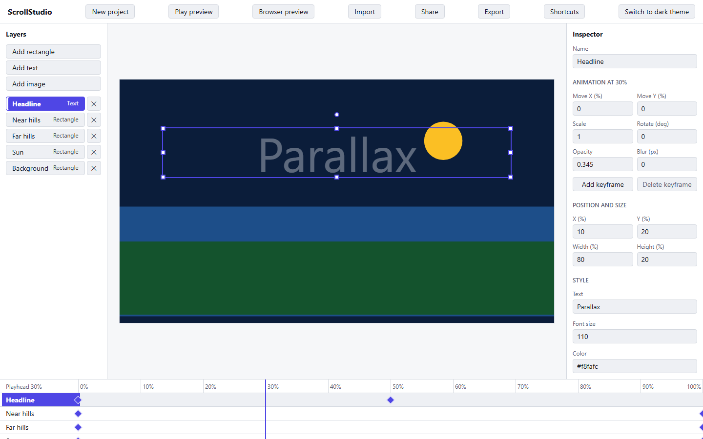
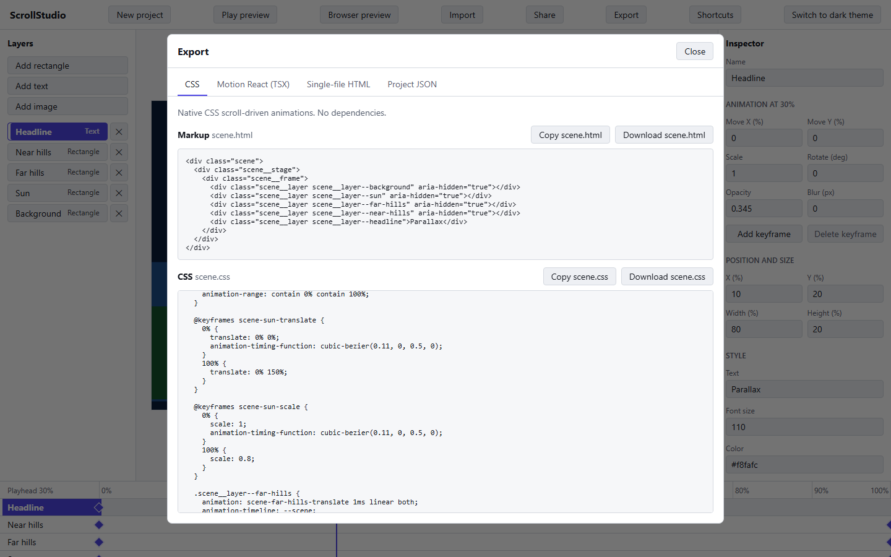
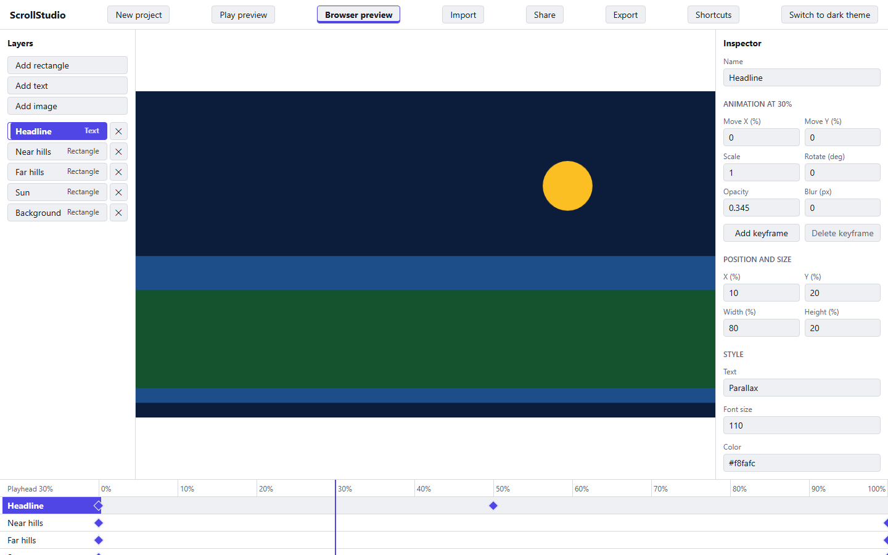

# ScrollStudio

A visual editor for scroll animations. You build a scene with layers and keyframes, preview it live, and export native CSS scroll-driven animations or Motion (React) code.

[](https://github.com/codewithfaseeh59/scroll-animation-studio/actions/workflows/ci.yml)
[](LICENSE)
[](https://scrollstudio-editor.vercel.app/)

[](https://scrollstudio-editor.vercel.app/)

## Screenshots

**Export dialog.** The CSS tab shows the generated markup and CSS, ready to copy or download.



**Browser preview.** The exported page runs in an iframe with real scrolling. Here it is scrolled to about 50%.



## What it is, and why I built it

ScrollStudio is a developer tool, not a no-code site builder. You lay out a scene on a stage, put keyframes on a scroll-progress timeline, and get code you can read and paste into a project.

I built it because scroll-driven animation is easy to describe and slow to tune by hand. Moving a keyframe and seeing the result right away is much faster than editing percentages in a stylesheet. It is also a project to learn from: the animation engine is plain TypeScript with tests, separate from the React interface.

## Features

- Stage with a fixed aspect ratio. Drag layers with snapping to the stage edges, the centre and other layers, and resize and rotate them with handles.
- Rectangle, text and image layers, with a layer list (add, select, delete).
- Inspector with numeric fields for position, size, style and the animated values.
- Timeline with a ruler from 0 to 100%, one row per layer, draggable keyframes and a scrubbable playhead.
- Auto-key: changing an animated value with the playhead at a position creates or updates a keyframe there.
- Eight easings per keyframe: linear, easeIn, easeOut, easeInOut, power2In, power2Out, power2InOut and sineInOut. Each one is mapped to a CSS timing function for export.
- Play preview in the editor, driven by the engine.
- Browser preview: the real exported CSS running in an iframe with real scrolling.
- Export: CSS (markup and stylesheet), Motion React (TSX), a single-file HTML page, and project JSON. Each file can be copied or downloaded.
- Import project JSON, and a share link that stores the project in the URL hash.
- Four templates: Fade-up title, Parallax layers, Zoom through and Slide-in cards.
- Undo and redo.
- Autosave to localStorage.
- Keyboard shortcuts (listed below) and a light and a dark theme.

Keyboard shortcuts:

| Keys | Action |
| --- | --- |
| Ctrl/Cmd + Z | Undo |
| Shift + Ctrl/Cmd + Z | Redo |
| K | Add a keyframe for the selected layer at the playhead |
| Delete or Backspace | Delete the selected keyframe, or the selected layer if no keyframe is selected |
| Arrow keys | Move the selected layer by 1% |
| Shift + Arrow keys | Move the selected layer by 10% |
| Space | Play or pause the preview |

The shortcuts do not fire while you type in a field or while a dialog is open. The same list is in the app under "Shortcuts".

## How it works

The editor is a React app, but the animation logic lives in a pure TypeScript engine in `src/engine/` that does not import React.

- **Types and validation** (`types.ts`, `validate.ts`): the project model (layers, keyframes, values) and a validator that checks unknown data and rebuilds a clean project from it.
- **Easing** (`ease.ts`): the eight easings. The CSS keyword easings use a cubic-bezier solver, and the power2 and sine easings are plain functions.
- **Interpolation** (`interpolate.ts`): before the first keyframe the first values are held, and after the last keyframe the last values are held. Between two keyframes, the second keyframe's easing shapes the way into it. A property a keyframe does not set is skipped, and the nearest keyframe that does set it is used.
- **Document operations** (`document.ts`): add, update and remove layers and keyframes. Keyframes stay sorted by progress, and removing a layer removes its keyframes.
- **History** (`history.ts`): undo and redo with a depth limit of 100 states.
- **Serialize and migrate** (`serialize.ts`, `migrate.ts`): the versioned project JSON, with a migration from the older version. The share link is the project compressed with gzip and encoded in the URL hash, with size limits and a safe error on bad input.
- **Autosave** (`src/store/persistence.ts`): saves the project to localStorage shortly after a change, and again when the page is hidden.
- **Code generation** (`src/engine/codegen/`): the CSS, Motion React and HTML exporters.

The zustand store in `src/store/editorStore.ts` holds the history, the selection and the playhead, and the components read from it.

## CSS export

The CSS exporter writes a stylesheet and the markup it styles. It follows these rules:

- A tall `.scene` element whose height is the scene length in viewport heights (a scene length of 4 gives `400vh`).
- A sticky stage inside it that fills the viewport, with a frame that keeps the project's aspect ratio.
- `view-timeline: --scene block` on `.scene`, and each animated layer uses `animation-timeline: --scene` with `animation-range: contain 0% contain 100%`.
- Layers are animated with the individual transform properties `translate`, `scale` and `rotate`, plus `opacity` and `filter` (for blur). Each property gets its own `@keyframes`.
- The animation rules are wrapped in `@supports (animation-timeline: view())`.
- Outside that block, each layer is drawn in its final state. This is the fallback for browsers without scroll-driven animations.
- A `prefers-reduced-motion: reduce` block removes the tall scene and the sticky stage and sets `animation: none`, so the final layout is static.

The Motion export uses `useScroll`, `useTransform` and `useReducedMotion` imported from `motion/react`.

## Browser support

CSS scroll-driven animations (`animation-timeline`) are supported in Chromium-based browsers and not in every browser. I have not listed version numbers here because I have not verified them. Check [MDN](https://developer.mozilla.org/en-US/docs/Web/CSS/animation-timeline) or [Can I use](https://caniuse.com/) for the current state.

The exported CSS is wrapped in `@supports (animation-timeline: view())`, so a browser without support shows the final layout instead of broken animation. The editor's Browser preview tests for support with `CSS.supports` and shows a message when the browser cannot run the animation. The scrub preview in the editor uses the engine, so it works in every browser the app runs in.

## Getting started

```bash
git clone https://github.com/codewithfaseeh59/scroll-animation-studio.git
cd scroll-animation-studio
npm install
npm run dev
```

Scripts from `package.json`:

| Script | What it does |
| --- | --- |
| `npm run dev` | Start the Vite dev server |
| `npm run build` | Typecheck and build for production |
| `npm run preview` | Serve the production build locally |
| `npm run typecheck` | Run the TypeScript compiler without emitting files |
| `npm run lint` | Run ESLint |
| `npm run format` | Format the code with Prettier |
| `npm test` | Run the unit tests (Vitest) |
| `npm run test:e2e` | Run the end-to-end tests (Playwright) |

## Testing

- **Unit and component tests** use Vitest with React Testing Library. They cover the engine (easing, interpolation, document operations, history, serialization, migration and the three exporters), the store, and the components, including an accessibility check of names, landmarks and tab order. Expected values in the tests are worked out by hand.
- **End-to-end tests** use Playwright with Chromium only. They add a layer with two keyframes and scrub the timeline, load a template, undo and redo from the keyboard, and open the exported HTML in a page and scroll it. The last test is skipped with a message if the browser does not support `animation-timeline`. Install the browser once with `npx playwright install chromium`, then run `npm run test:e2e`.
- **CI** is a GitHub Actions workflow (`.github/workflows/ci.yml`). On pushes to `main` and on pull requests it runs lint, typecheck, unit tests, the build and the end-to-end tests. The Playwright report is uploaded only when a step fails.

## Project structure

```
src/
  engine/      Pure TypeScript: types, validation, easing, interpolation,
               document operations, history, serialize, migrate, playback
    codegen/   The CSS, Motion React and single-file HTML exporters
  store/       The zustand editor store and autosave
  components/  AppShell, Toolbar, LayerList, Stage, Inspector, Timeline,
               BrowserPreview, and the Export, New project and Shortcuts dialogs
  hooks/       Dragging, timeline scrubbing, shortcuts, playback, theme, import and share
  lib/         Small helpers: geometry and snapping, clamp, ids, download, clipboard
  templates/   The four starter projects
  styles/      Design tokens (CSS variables) and global styles
e2e/           Playwright tests
docs/          README screenshots
```

## Design decisions

- **No animation library inside the editor.** The preview is driven by my own engine. The generated Motion code is only something the tool writes out, not something the editor runs.
- **The engine is separate from the UI.** It has no React imports, so it can be tested alone and could be reused.
- **Immutable document operations.** Every operation returns a new project, or the same project when nothing changed. This makes undo simple and lets the UI see changes by comparing references.
- **History with `amend`.** Each edit is one undo step. A held arrow key or a run of keyframe moves is joined into one step: `amend` replaces the current state without adding a step, as long as the edits are the same kind and come within one second of each other.
- **Every exported file handles reduced motion and missing support.** The final layout is the fallback in both cases.

## Known limits

- `translateX` and `translateY` are exported together as one `translate` property, so they share keyframe positions and easings in the CSS.
- In the CSS export, the power2 and sine easings are approximated with cubic-bezier curves. I measured the largest difference from the exact functions at about 0.53%. The Motion export uses the exact functions.
- There is no split text and no pinned sections.
- The generated Motion component is checked for syntax and imports by the tests, but the test suite does not run it in a browser.
- The stage's resize and rotate handles work with a pointer only. The inspector fields and the arrow-key shortcuts are the keyboard alternative.
- The editor can be used with a keyboard and its controls have accessible names, but I have not had it audited with a screen reader.

## Roadmap

These are ideas, not promises.

- More templates.
- More easings, or a custom cubic-bezier editor.
- Publish the engine as an npm package.
- Separate keyframes for the X and Y movement of a layer.

## License

[MIT](LICENSE)

Built with Claude Code as a pair programmer; every step was reviewed, tested and committed by me.
